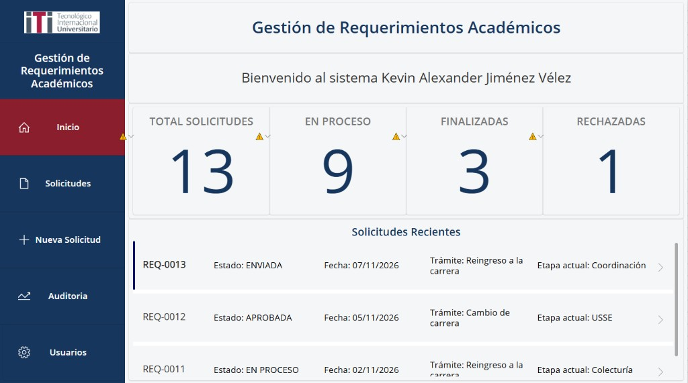
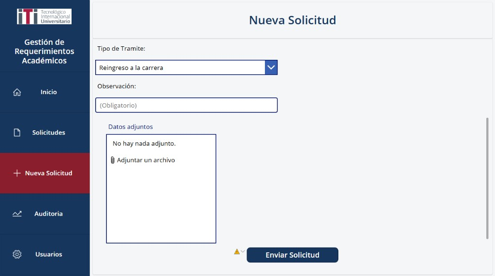
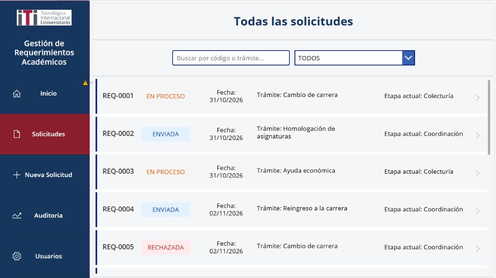
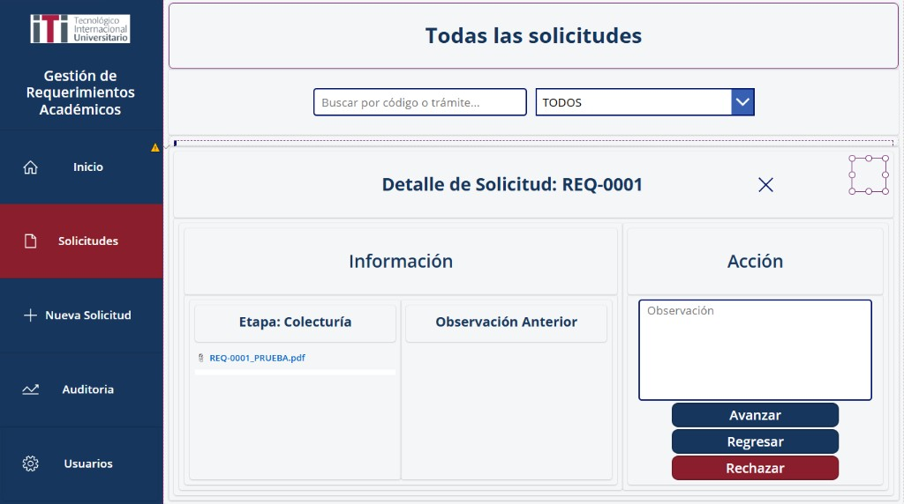
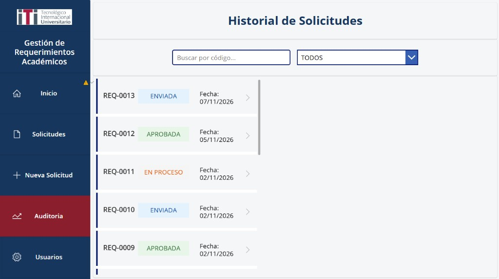
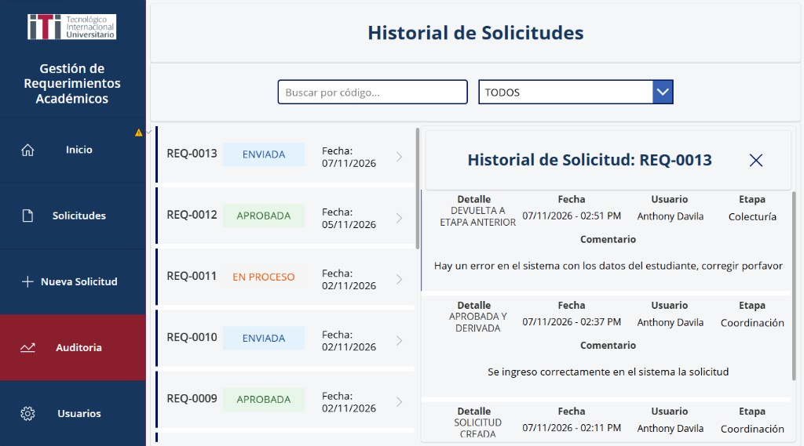
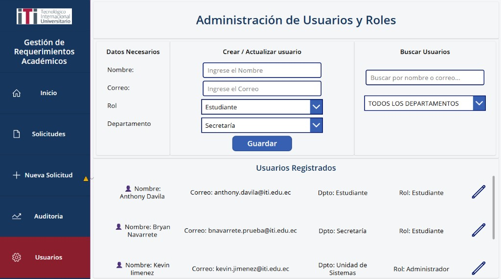

# Manual de usuario  
## Gestión de Requerimientos Académicos — ITI

Aplicación Canvas en Microsoft Power Apps para registrar, seguir y auditar trámites académicos del Instituto Tecnológico Internacional Universitario (ITI).

**Autores:** Anthony David Dávila Pintado · Kevin Alexander Jiménez Vélez

---

## 1. Acceso al sistema

1. Abre la aplicación desde el enlace o el portal de Power Apps del entorno institucional.  
2. Inicia sesión con tu **correo institucional** (Microsoft Entra ID).  
3. La aplicación identifica tu nombre, rol y departamento para mostrar la información que te corresponde.

No necesitas una contraseña aparte de la de tu cuenta ITI.

Al entrar verás la pantalla de bienvenida y el menú lateral:

### Menú lateral

| Opción | Para qué sirve |
|---|---|
| **Inicio** | Dashboard con indicadores y solicitudes recientes |
| **Solicitudes** | Listado / bandeja de trabajo |
| **Nueva Solicitud** | Crear un trámite |
| **Auditoría** | Consultar el historial de actuaciones |
| **Usuarios** | Administrar cuentas, roles y departamentos (uso administrativo) |

---

## 2. Inicio (Dashboard)

Desde **Inicio** se muestra un resumen del estado de las solicitudes y las más recientes.

### Indicadores

| Indicador | Significado |
|---|---|
| **Total solicitudes** | Cantidad de requerimientos registrados |
| **En proceso** | Trámites que aún no están cerrados |
| **Finalizadas** | Trámites aprobados / concluidos |
| **Rechazadas** | Trámites denegados |

En **Solicitudes recientes** cada fila muestra:

- código (`REQ-####`)  
- estado  
- fecha  
- tipo de trámite  
- etapa actual (por ejemplo Coordinación, Colecturía, USSE)

---

## 3. Crear una nueva solicitud (estudiante)

### Pasos

1. En el menú, selecciona **Nueva Solicitud**.  
2. En **Tipo de Trámite**, elige el procedimiento (por ejemplo *Reingreso a la carrera*, *Cambio de carrera*, *Homologación de asignaturas*, *Ayuda económica*, etc.).  
3. Completa el campo **Observación** (obligatorio): explica el motivo o los datos relevantes del trámite.  
4. Si debes respaldar el pedido, usa **Adjuntar un archivo** (PDF u otro documento permitido).  
5. Pulsa **Enviar Solicitud**.

### Qué ocurre al enviar

- Se genera un código correlativo con formato **`REQ-####`**.  
- El sistema asigna automáticamente la **primera etapa** según el tipo de trámite.  
- Si adjuntaste un archivo, se almacena en SharePoint y queda vinculado a la solicitud.  
- Se notifica por correo al responsable del departamento de la etapa.

Puedes consultar tu solicitud después en **Inicio**, **Solicitudes** o **Auditoría**.

---

## 4. Consultar y gestionar solicitudes

### 4.1 Listado

1. Entra a **Solicitudes**.  
2. Usa el buscador (*Buscar por código o trámite…*) o el filtro de estado (**TODOS** / estados específicos).  
3. Selecciona una fila (flecha `>`) para abrir el detalle.

Cada tarjeta muestra código, estado (con color), fecha, trámite y etapa actual.

### 4.2 Detalle y acciones del área responsable

Cuando abres una solicitud, el panel de detalle muestra:

- etapa actual  
- documento adjunto (si existe)  
- observación anterior  
- campo para una nueva **Observación**  
- botones de acción

| Acción | Efecto |
|---|---|
| **Avanzar** | Aprueba la revisión en la etapa actual y deriva a la siguiente (o finaliza si no hay más etapas) |
| **Regresar** | Devuelve la solicitud a una etapa anterior, con comentario obligatorio en la práctica operativa |
| **Rechazar** | Cierra el trámite como `RECHAZADA` |

**Obligatorio:** escribir una observación clara antes de avanzar, regresar o rechazar. Esa nota queda en el historial y ayuda a quien atienda después.

La bandeja del personal de área se orienta a las solicitudes de su **departamento**. Un estudiante normalmente ve solo las suyas.

---

## 5. Auditoría (historial)

1. Entra a **Auditoría**.  
2. Busca por código o filtra por estado.  
3. Abre una solicitud para ver el **historial completo**.

En el detalle del historial aparecen, en orden cronológico, eventos como:

- **SOLICITUD CREADA**  
- **APROBADA Y DERIVADA**  
- **DEVUELTA A ETAPA ANTERIOR**  
- otras actuaciones según el flujo  

Cada evento indica fecha/hora, usuario, etapa y comentario.

Usa esta pantalla cuando necesites evidenciar *quién hizo qué* y *en qué momento*.

---

## 6. Administración de usuarios (Administrador)

Disponible para perfiles con permisos de administración.

### Crear o actualizar un usuario

1. Completa **Nombre** y **Correo**.  
2. Selecciona **Rol** (por ejemplo Estudiante, Administrador).  
3. Selecciona **Departamento** (Secretaría, Coordinación, Sistemas, etc.).  
4. Pulsa **Guardar**.

### Buscar usuarios

- Busca por nombre o correo.  
- Filtra por departamento (*TODOS LOS DEPARTAMENTOS* o uno específico).  
- Usa el ícono de editar (lápiz) para corregir un registro existente.

Un usuario de área debe estar **activo** y con el departamento correcto para recibir notificaciones y ver la bandeja adecuada.

---

## 7. Estados y colores (referencia rápida)

| Estado | Color típico | Significado |
|---|---|---|
| **ENVIADA** | Azul | Recién registrada / pendiente en la etapa |
| **EN PROCESO** | Naranja | En atención dentro del flujo |
| **APROBADA** | Verde | Finalizada favorablemente |
| **RECHAZADA** | Rojo | Denegada |

---

## 8. Flujo general completo

### Estudiante

1. Inicia sesión.  
2. **Nueva Solicitud** → tipo + observación (+ adjunto).  
3. Envía y anota el código `REQ-####`.  
4. Consulta avance en **Inicio** / **Solicitudes** / **Auditoría**.

### Personal de área (Coordinación, Colecturía, Secretaría, etc.)

1. Inicia sesión.  
2. Revisa **Solicitudes** (bandeja de su departamento).  
3. Abre el caso, revisa adjunto y observación.  
4. Registra su observación y elige **Avanzar**, **Regresar** o **Rechazar**.  
5. Verifica la traza en **Auditoría** si hace falta.

---

## 9. Preguntas frecuentes

**¿Puedo entrar sin cuenta ITI?**  
No. La autenticación es institucional (Microsoft Entra ID).

**¿La observación es obligatoria al crear?**  
Sí. El formulario la marca como obligatoria.

**¿Dónde queda el archivo que adjunto?**  
En SharePoint; en la base de datos solo se guardan metadatos (nombre, ruta, fecha, solicitud).

**¿Por qué no veo todas las solicitudes?**  
Por diseño: estudiantes ven las propias; el personal de área ve las de su departamento / rol.

**¿Quién configura roles y departamentos?**  
El administrador, desde el módulo **Usuarios**.

**¿La app sustituye la normativa académica?**  
No. Solo formaliza el registro, las etapas, la evidencia y el historial para apoyar el trámite institucional.

---

*Documento orientado a usuarios finales del prototipo funcional del componente práctico. Para la visión técnica general, consulta el [README](../README.md) del repositorio.*
